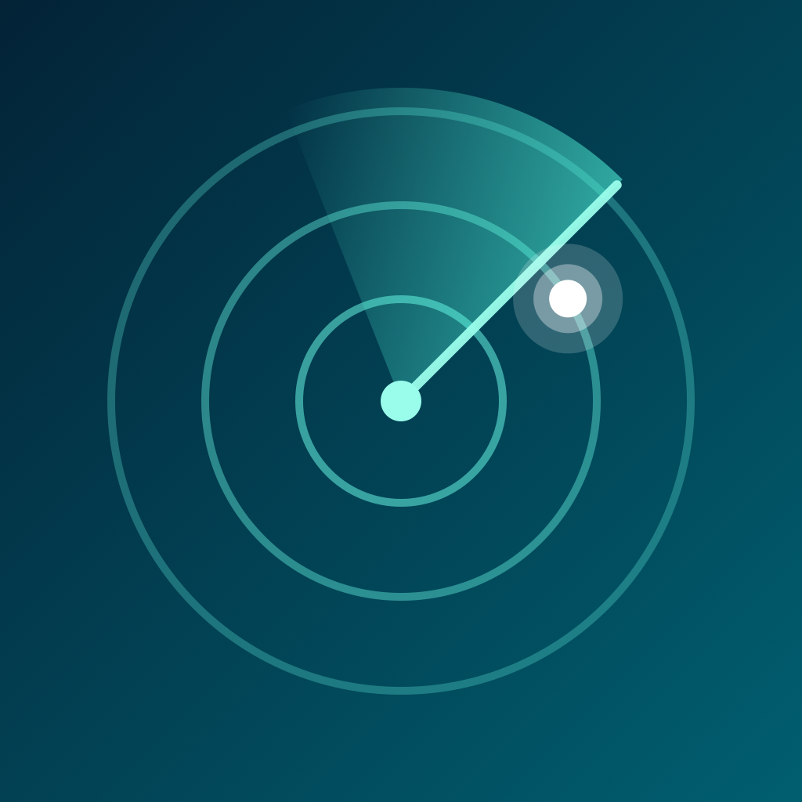
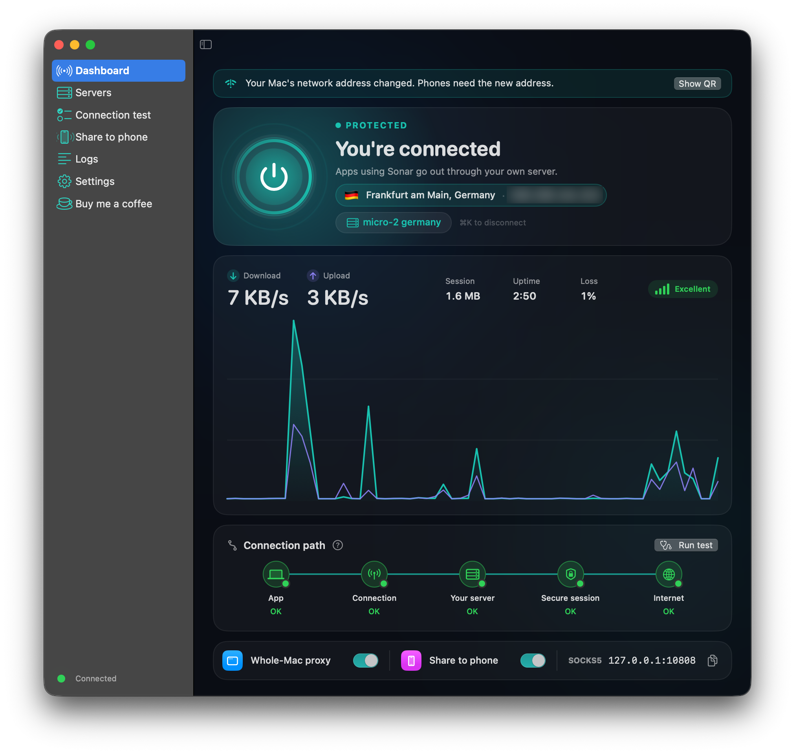
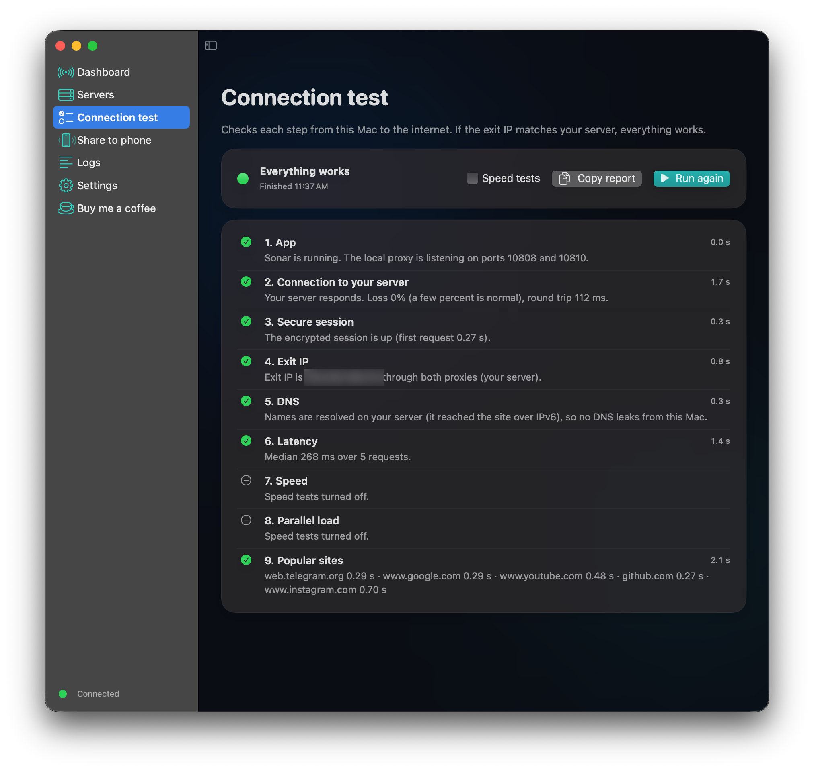

<p align="center">
  
</p>

<h1 align="center">Sonar</h1>

<p align="center">
  <b>A private connection to your own server, for networks where other tools fail.</b><br>
  For macOS, and your phone through your Mac.
</p>

<p align="center">
  <a href="https://github.com/g3ntrix/sonar/releases/latest"><b>Download for Mac</b></a>
  &nbsp;·&nbsp; macOS 13 or newer &nbsp;·&nbsp; Apple silicon and Intel
</p>

<p align="center">
  
  
</p>

## What it does

Some networks block or throttle almost everything: VPNs stall, proxies drop, speeds crawl. Sonar connects your Mac to
a small server you own, in a way that still gets through on many of those networks.

You don't need to know anything about networking. A step-by-step setup takes you from "I have a server" to a working
connection in a few minutes.

## Get started

1. **Download** the `.dmg` from [Releases](https://github.com/g3ntrix/sonar/releases/latest), open it and drag
   **Sonar** into **Applications**.
2. **Open Sonar.** If macOS says it can't open it, go to **System Settings → Privacy & Security**, scroll down and
   click **Open Anyway**. (Sonar isn't notarized by Apple, so macOS asks once.)
3. **Follow the setup.** Enter your server's IP, paste the one command Sonar gives you into your server, and wait for
   the green check.
4. **Press the big button** to connect.

### What you need

- A small Linux server (VPS) running **Ubuntu or Debian**. The cheapest plan is enough: Hetzner, DigitalOcean, Vultr
  and others work.
- A way to log in to it. Your provider shows you how when you create it.

## Features

- **One-paste server setup** with live checks, and help for your provider's firewall
- **Whole-Mac proxy** with one switch, or use the local SOCKS5/HTTP proxy in the apps you choose
- **Share to phone** by scanning a QR code (V2Box, v2rayNG, NekoRay). Phone and Mac must be on the same Wi-Fi
- **Connection test** that checks every step and tells you what's wrong in plain words
- **Live speed** and connection health on the dashboard, plus a menu bar icon
- **Several servers**, and a quick fix when your server's IP changes

On networks where UDP works, try [Veil](https://github.com/g3ntrix/veil), Sonar's faster sibling.

## Privacy

No ads, no accounts, no tracking. Passwords and keys are created on your Mac and stay there. Sonar only talks to your
own server, and to GitHub to check for updates.

## Buy me a coffee

Sonar is free. If it's useful to you, a coffee helps support its development:

| Coin | Address |
|---|---|
| USDT (BEP20) | `0x71F41696c60C4693305e67eE3Baa650a4E3dA796` |
| TON | `UQCriHkMUa6h9oN059tyC23T13OsQhGGM3hUS2S4IYRBZgvx` |
| TRX (TRON) | `TFrCzU7bDey9WSh3fhqCBqhaiMzr8VhcUV` |

<details>
<summary><b>Building from source</b></summary>

Requires Xcode 15+ (Swift 5.9) and Go 1.26+.

```bash
./scripts/build-app.sh       # dist/Sonar.app (universal, ad-hoc signed)
./scripts/make-dmg.sh        # dist/Sonar-<version>.dmg
```

Tests: `swift test` and `cd Helpers/relayd && go test ./...`. The version lives in `VERSION`.

| Path | What |
|---|---|
| `Sources/Sonar/App` | App entry, branding, app state |
| `Sources/Sonar/Shared` | Models, services and shared UI |
| `Sources/Sonar/Views` | Setup, dashboard, test, servers, sharing, logs, settings |
| `Sources/Sonar/Resources/Server` | Server install and check scripts |
| `Helpers/relayd` | Go helper used by the app |
| `scripts/` | Build, DMG and release scripts |

Run `./scripts/check-secrets.sh` before committing. Put your own server IPs, one per line, in
`.private/leak-needles.txt` (untracked) so they never end up in the repo.

Known limits: one Mac per server at a time (a phone connects through the Mac). Releases are ad-hoc signed and not
notarized.

</details>

## License

Free and open source under the [GPL-3.0](LICENSE). Made by [g3ntrix](https://github.com/g3ntrix).
Includes [Xray-core](https://github.com/XTLS/Xray-core) (MPL-2.0).
